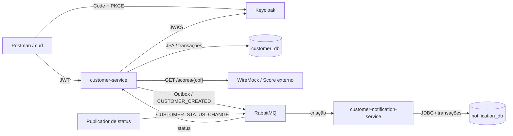

# Datum Customer Services

Gerenciamento de clientes com Java 21, Spring Boot 3.5.16, Maven Wrapper 3.9.9, PostgreSQL, OAuth 2.0/JWT e RabbitMQ. Dois serviços de negócio independentes: **customer-service** mantém clientes e consulta Score externo; **customer-notification-service** registra uma notificação simulada por evento de criação, em banco próprio.

## Comece por aqui

1. [Inicie o ambiente](#iniciar-com-docker-compose) e obtenha [tokens USER e ADMIN](#obter-access-tokens).
2. Execute os [exemplos da API](#usar-a-api) ou o [roteiro de demonstração](guides/demo.md), com resultados esperados e consultas de conferência.
3. Consulte a [arquitetura](architecture/README.md), as [decisões e alternativas](architecture/decisions/README.md) e a [matriz de requisitos e testes](guides/requirements.md).

O enunciado exige CRUD, busca/filtro, integração HTTP de Score, Resource Server com USER/ADMIN, publicação de CUSTOMER_CREATED, consumo de CUSTOMER_STATUS_CHANGE, consistência sob duplicatas, banco relacional/JPA, validações, testes e containers. Keycloak, PostgreSQL, os dois serviços escolhidos, notificações simuladas, outbox/inbox, exclusão lógica, retries/DLQ e JMeter são decisões desta implementação. Não há envio de e-mail real. A pasta `docs/` contém material local e não é enviada ao Git; todas as instruções necessárias ao avaliador estão versionadas nos links acima.

## Arquitetura



Os bancos compartilham somente o servidor PostgreSQL local: credenciais e permissões são segregadas, sem consultas entre serviços. A notificação não chama a API de clientes. WireMock representa uma dependência externa, não um terceiro serviço de negócio. Diagramas de sequência, tabelas, fronteiras transacionais e garantias estão na [arquitetura detalhada](architecture/README.md).

## Iniciar com Docker Compose

Pré-requisitos: Docker ativo com BuildKit, Compose v2 ou posterior e acesso ao Docker Hub, Quay e Maven Central na primeira construção. Os limites dos seis serviços somam aproximadamente **5,25 GiB**; reserve margem para builds, Docker e outros processos. O caminho de containers dispensa Java, Maven e Python instalados no host.

Clone o repositório e entre na raiz:

```sh
git clone https://github.com/rparenato13/datum-customer-service.git
cd datum-customer-service
```

Somente em um clone novo:

```sh
cp .env.example .env
```

Revise as credenciais de demonstração. Se já possui `.env` e volumes, preserve suas credenciais. Libere 8080/8081 dos JARs locais ou ajuste as portas HTTP no `.env`. Com a configuração preparada, **um comando inicia toda a solução**:

```sh
docker compose up --build -d
```

O bootstrap do RabbitMQ é automático; não é necessário executar `configure.py`. Confira a convergência:

```sh
docker compose ps -a
curl -i http://localhost:8080/actuator/health
curl -i http://localhost:8081/actuator/health
```

Esperado: seis serviços `healthy`, job `rabbitmq-init` com `Exited (0)` e ambos os healths com HTTP 200 / `{"status":"UP"}`. `up -d` retorna antes de toda a convergência; acompanhe os healthchecks e logs. Os consumidores processam também mensagens pendentes ao iniciar. O [runbook Compose](infra/compose/README.md) explica bootstrap, recursos, reinício e diagnóstico.

### Endereços locais

Todos os ports publicados estão limitados a `127.0.0.1`. URLs abaixo usam os defaults; ajuste os exemplos caso altere portas.

| Componente | Endereço / porta | Acesso |
|---|---|---|
| API de clientes | [localhost:8080/customers](http://localhost:8080/customers) | Bearer USER ou ADMIN |
| Swagger UI | [Swagger](http://localhost:8080/swagger-ui/index.html) | Público; Authorize para operações |
| OpenAPI JSON / YAML | [JSON](http://localhost:8080/v3/api-docs) / [YAML](http://localhost:8080/v3/api-docs.yaml) | Público |
| Health customer / notification | [8080](http://localhost:8080/actuator/health) / [8081](http://localhost:8081/actuator/health) | Público, sem detalhes internos |
| Keycloak | [Console](http://localhost:18090/admin/) | `keycloak_admin`, senha `KEYCLOAK_ADMIN_PASSWORD` |
| RabbitMQ Management | [Console](http://localhost:15672/) | `rabbitmq_admin`, senha `RABBITMQ_ADMIN_PASSWORD` |
| RabbitMQ AMQP | `localhost:15673`, vhost `datum` | Contas por papel, sem guest |
| PostgreSQL | `localhost:15432` | Banco/usuário próprios, conforme tabela abaixo |
| WireMock | [Score de demonstração](http://localhost:18082/scores/16899535009) | Simulador local |
| Métricas customer | [Prometheus](http://localhost:8080/actuator/prometheus) | Perfil observability + Bearer ADMIN |
| Métricas notification | [Prometheus](http://localhost:8081/actuator/prometheus) | Perfil observability + Basic de monitoramento |

Prometheus/Grafana como servidores e integração Dynatrace não estão instalados. Os dashboards HTML do JMeter são arquivos locais gerados pelo teste de performance.

| Database no DBeaver | Usuário | Senha definida por |
|---|---|---|
| `customer_db` | `customer_app` | `CUSTOMER_DB_PASSWORD` |
| `notification_db` | `notification_app` | `NOTIFICATION_DB_PASSWORD` |

Desmarque “Show all databases”. Não use Database `postgres` para essas contas: CONNECT é restrito ao banco correspondente.

## Obter Access Tokens

Use Postman, autorização **OAuth 2.0 → Authorization Code (With PKCE)**, com autorização pelo browser:

| Campo | Valor |
|---|---|
| Callback | `https://oauth.pstmn.io/v1/callback` ou `https://oauth.pstmn.io/v1/browser-callback` |
| Auth URL | `http://localhost:18090/realms/datum/protocol/openid-connect/auth` |
| Access Token URL | `http://localhost:18090/realms/datum/protocol/openid-connect/token` |
| Client ID | `datum-local` |
| Client Secret | Vazio, cliente público |
| Scope / Code Challenge Method | `openid` / `SHA-256 (S256)` |
| Client Authentication | Client ID no corpo, sem secret |

| Login | Perfil da API | Senha padrão exclusivamente local |
|---|---|---|
| `api-user` | USER: consultas | `user_local_only` |
| `api-admin` | ADMIN: consultas e escrita | `admin_local_only` |

As senhas efetivas são `KEYCLOAK_DEMO_USER_PASSWORD` e `KEYCLOAK_DEMO_ADMIN_PASSWORD`. Ao trocar o usuário, encerre a sessão anterior ou use `prompt=login` nos parâmetros de autorização. Tokens duram cinco minutos; renove ao receber 401 por expiração. Não use grant password: ele está desabilitado. A conta administrativa do console Keycloak é diferente de `api-admin`.

No Swagger, **Authorize → bearerAuth**, cole somente o access token, sem prefixo Bearer. No terminal, os exemplos usam variáveis em memória. Python 3 é necessário somente para os prompts abaixo e ferramentas auxiliares; no Postman é dispensável:

```sh
export TOKEN_ADMIN="$(python3 -c 'import getpass; print(getpass.getpass("Access token ADMIN: "))')"
export TOKEN_USER="$(python3 -c 'import getpass; print(getpass.getpass("Access token USER: "))')"
export BASE_URL=http://localhost:8080
```

O texto digitado no prompt fica oculto e não entra no histórico do shell. Não registre tokens no Git ou em capturas. A API verifica assinatura RS256, issuer canônico `http://localhost:18090/realms/datum`, audiência `customer-api`, validade e roles. No Compose, as chaves são buscadas pelo JWKS interno, mantendo a mesma validação de issuer.

## Usar a API

### Operações e respostas

| Método / caminho | Perfil | Sucesso | Erros típicos |
|---|---|---|---|
| POST `/customers` | ADMIN | 201 + Location | 400 inválido, 409 CPF reservado |
| GET `/customers/{id}` | USER / ADMIN | 200 | 400 ID inválido, 404 ausente/excluído |
| PUT `/customers/{id}` | ADMIN | 200 | 400, 404, 409 CPF/conflito concorrente |
| DELETE `/customers/{id}` | ADMIN | 204 | 400, 404 inclusive repetição |
| GET `/customers` | USER / ADMIN | 200 paginado | 400 parâmetros |
| GET `/customers/search` | USER / ADMIN | 200 paginado | 400 nome ausente/parâmetros |
| GET `/customers/{id}/score` | USER / ADMIN | 200 | 400, 404, 502, 503, 504 |

Todas as operações de negócio retornam 401 sem JWT válido e 403 sem a permissão correspondente. Erros padronizados usam `application/problem+json`, com `title`, `status`, `detail`, `code`, `instance` e correlação; validações incluem `errors` sem valores rejeitados. O [OpenAPI em execução](http://localhost:8080/v3/api-docs) é a referência de schemas, exemplos e respostas por operação.

`status` aceita ACTIVE/INACTIVE. Nome, CPF sem máscara com 11 dígitos verificadores válidos e e-mail são obrigatórios. CPF é único inclusive após exclusão lógica. `id`, `version` e timestamps são gerados pelo servidor. `PUT` substitui os quatro campos de entrada; `version` é somente leitura no REST. `DELETE` preenche `deleted_at`, preserva linha/status e oculta o cliente das consultas.

Listagem e busca aceitam `page` (default 0, mínimo 0), `size` (default 20, 1–100), `status` opcional. A ordenação é por ID crescente; combinações cujo offset exceda inteiro de 32 bits são recusadas. Em search, `name` é obrigatório, busca parcial sem diferenciar caixa, preservando acentos e tratando curingas como texto literal.

### Criar, consultar e buscar

Exemplos para uma base nova, com dados sintéticos. Se o CPF já estiver reservado, o POST retorna 409; use o cliente já existente quando aplicável ou outro CPF de teste válido. Não apague o ambiente apenas para repetir um exemplo.

```sh
curl -i -X POST "$BASE_URL/customers" \
  -H "Authorization: Bearer $TOKEN_ADMIN" \
  -H 'Content-Type: application/json' \
  -H 'X-Correlation-Id: 8cda6187-f732-4ae3-966d-c9654b01c089' \
  -d '{"name":"Ana Demonstração","cpf":"16899535009","email":"ana@example.test","status":"ACTIVE"}'
```

Espere 201 e `Location: /customers/<id>`. Guarde o ID real na variável abaixo; não suponha que será 1:

```sh
export CUSTOMER_ID="$(python3 -c 'print(int(input("ID retornado no POST: ")))')"
curl -i "$BASE_URL/customers/$CUSTOMER_ID" -H "Authorization: Bearer $TOKEN_USER"
curl -i "$BASE_URL/customers?page=0&size=1&status=ACTIVE" -H "Authorization: Bearer $TOKEN_USER"
curl -i --get "$BASE_URL/customers/search" \
  -H "Authorization: Bearer $TOKEN_USER" \
  --data-urlencode 'name=ANA' --data-urlencode 'status=ACTIVE'
curl -i "$BASE_URL/customers/$CUSTOMER_ID/score" -H "Authorization: Bearer $TOKEN_USER"
```

Na base nova, a listagem contém o cadastro e a busca encontra o nome. O Score dessa fixture retorna `{"customerId":<id>,"score":750,"classification":"LOW_RISK"}`. A resposta paginada contém `content,page,size,totalElements,totalPages,first,last`.

Score é consultado diretamente no provedor após encerrar a transação de leitura do cliente. Não é armazenado em banco nem cache. Cliente INACTIVE continua consultável; excluído retorna 404 sem chamar o provedor. Defaults: conexão 500 ms, leitura 1000 ms e até duas tentativas totais, com pausa de 100 ms apenas para I/O sem timeout ou HTTP 500/502/503/504 do provedor. Timeout e 404 não são repetidos. Resposta inválida → 502/SCORE_INVALID_RESPONSE; indisponibilidade → 503/SCORE_UNAVAILABLE; timeout → 504/SCORE_TIMEOUT; Score ausente no provedor → 404/SCORE_NOT_FOUND. As [fixtures](infra/wiremock/mappings) incluem respostas válidas, falhas e atraso de três segundos.

### Alterar e excluir

```sh
curl -i -X PUT "$BASE_URL/customers/$CUSTOMER_ID" \
  -H "Authorization: Bearer $TOKEN_ADMIN" -H 'Content-Type: application/json' \
  -d '{"name":"Ana Atualizada","cpf":"16899535009","email":"ana.atualizada@example.test","status":"INACTIVE"}'
```

Espere 200, `version` incrementada e novo `updatedAt`. Antes de excluir, conclua a demonstração AMQP abaixo se quiser usar esse mesmo cliente.

```sh
curl -i -X DELETE "$BASE_URL/customers/$CUSTOMER_ID" -H "Authorization: Bearer $TOKEN_ADMIN"
curl -i "$BASE_URL/customers/$CUSTOMER_ID" -H "Authorization: Bearer $TOKEN_USER"
```

Espere 204, depois 404/CUSTOMER_NOT_FOUND. Uma nova exclusão retorna 404. PUT, status AMQP e DELETE não emitem outro CUSTOMER_CREATED.

## RabbitMQ, consistência e notificações

Contratos e exemplos aprovados: [contracts/events](contracts/events/README.md), [topologia](contracts/events/topology.v1.json), schemas [criação](contracts/events/schemas/customer-created.v1.schema.json) e [status](contracts/events/schemas/customer-status-change.v1.schema.json). O JSON v1 usa `eventId,eventType,schemaVersion,occurredAt,customerId`; status inclui `status,expectedVersion`. Não envie os exemplos conceituais do enunciado diretamente: o contrato implementado exige envelope versionado e controle de concorrência.

| Evento | Exchange / routing key | Fila principal |
|---|---|---|
| CUSTOMER_CREATED | `datum.customer.events` / `customer.created.v1` | `customer-notification-service.created.v1` |
| CUSTOMER_STATUS_CHANGE | `datum.customer.events` / `customer.status-change.v1` | `customer-service.status-change.v1` |

Cada fila principal possui `.retry.1`, `.retry.2`, `.retry.3` (TTL 5/30/120 s) e `.dlq`: dez filas quorum duráveis no vhost `datum`. Exchanges internos: `datum.customer.retry`, `datum.customer.redelivery`, `datum.customer.dead`. Permissões por recurso/routing key separam administração, produtor de criação, consumidor de notificação e publicador de status.

Cadastro e outbox são gravados no mesmo commit. O relay usa lease, mandatory publish, publisher confirm e verificação de return; só então marca PUBLISHED. Broker fora conserva PENDING com backoff de 1/2/4/8/16/30 s, sem limite de tentativas; evento estruturalmente inválido fica BLOCKED. **201 confirma o cadastro, PUBLISHED confirma a publicação, inbox confirma o efeito no consumidor.** As três evidências representam momentos distintos.

Consumidores fazem efeito e inbox no mesmo commit e só depois ACK. Duplicata de mesmo ID/conteúdo não repete o efeito; ID reaproveitado com conteúdo diferente é rejeitado. Status requer a versão atual; versão obsoleta vai à DLQ e registra REJECTED/VERSION_CONFLICT. Não existe ordenação global: esperas/reentregas podem reordenar eventos. A garantia é entrega ao menos uma vez com deduplicação transacional local; não há promessa de exactly-once entre sistemas.

Em falha transitória, publica-se cópia confirmada no retry antes de ACK da origem. Exaustão ou falha permanente levam à DLQ, sem replay automático. Confirm sem ACK pode gerar duplicata; o inbox absorve esse caso. Limites de filas rejeitam excesso e `delivery-limit=5` nas principais protege contra crashes repetidos. [Detalhes e limitações](architecture/README.md).

### Publicar mudança de status

Prepare as ferramentas auxiliares uma vez (Python 3.10+, macOS/Linux; no Windows use WSL compatível):

```sh
python3 -m venv infra/rabbitmq/.venv
infra/rabbitmq/.venv/bin/python -m pip install -r infra/rabbitmq/requirements-test.txt
```

Consulte um cliente **não excluído** e copie sua `version` atual, inclusive se já executou PUT ou outro evento:

```sh
curl -i "$BASE_URL/customers/$CUSTOMER_ID" -H "Authorization: Bearer $TOKEN_USER"
export EXPECTED_VERSION="$(python3 -c 'print(int(input("version atual do GET: ")))')"
infra/rabbitmq/.venv/bin/python infra/rabbitmq/publish_status.py \
  --customer-id "$CUSTOMER_ID" --expected-version "$EXPECTED_VERSION" --status INACTIVE
```

O script gera/salva um UUID novo em `.local/rabbitmq/status-events/` e publica com a conta restrita `status_publisher`. Confirm do broker não prova alteração. Confira GET do cliente, inbox APPLIED e versão incrementada, como no [roteiro de demonstração](guides/demo.md). Para duplicata, use `--file` com o caminho **real** impresso, preservando ID e bytes; executar novamente o comando de criação gera outra intenção.

No RabbitMQ UI, inspecione Ready/Unacked, consumidores e as duas DLQs. Evite “Get messages”, purge ou remoção como forma de conferir consumo. Em `notification_db`, consulte `notification_records` e `notification_event_inbox`: o efeito é CUSTOMER_CREATED_SIMULATION, sem envio externo. Consultas SQL, replay de criação e resultados esperados estão no [roteiro](guides/demo.md).

## Configuração, desenvolvimento e limpeza

A [.env.example](.env.example) documenta todos os parâmetros. Compose lê `.env`; Java/IDE precisa receber variáveis exportadas explicitamente. Consulte a [execução pelo Maven/JAR](guides/development.md).

| Grupo | Parâmetros principais / efeito |
|---|---|
| Portas | `CUSTOMER_HTTP_PORT, NOTIFICATION_HTTP_PORT, POSTGRES_PORT, KEYCLOAK_PORT, WIREMOCK_PORT, RABBITMQ_AMQP_PORT, RABBITMQ_MANAGEMENT_PORT` |
| Credenciais | `*_DB_PASSWORD`, `POSTGRES_ADMIN_PASSWORD`, `KEYCLOAK_*PASSWORD`, `*_RABBITMQ_PASSWORD`, `RABBITMQ_ADMIN_PASSWORD` |
| Segurança/docs | `CUSTOMER_JWT_*` para JAR no host; `CUSTOMER_DOCS_ENABLED=false` desliga UI/OpenAPI |
| Score | `SCORE_CONNECT_TIMEOUT_MS, SCORE_READ_TIMEOUT_MS, SCORE_MAX_ATTEMPTS, SCORE_RETRY_DELAY_MS` |
| Publicação | `OUTBOX_PUBLISHER_ENABLED, OUTBOX_BATCH_SIZE, OUTBOX_POLL_DELAY_MS, OUTBOX_CONFIRM_TIMEOUT_MS, OUTBOX_LEASE_MS` |
| Consumidores | `STATUS_CONSUMER_*`, `NOTIFICATION_CONSUMER_*`: enabled, prefetch, recovery e confirm timeout |
| Banco | `CUSTOMER_DB_*` e `NOTIFICATION_DB_*`: pool, connect/socket/query/lock/transaction timeouts |
| Observabilidade | `APP_PROFILES=observability`, `APP_ENVIRONMENT`, `DB_SLOW_QUERY_THRESHOLD_MS`, `NOTIFICATION_MANAGEMENT_PASSWORD` |
| Recursos Docker | `*_MEMORY_LIMIT`, `CUSTOMER_JAVA_TOOL_OPTIONS`, `NOTIFICATION_JAVA_TOOL_OPTIONS` |

No Compose, DB, AMQP, Score e JWKS usam endereços internos definidos na composição; os URLs de host da `.env.example` destinam-se à IDE/JAR. Alterar senhas no arquivo não gira automaticamente credenciais já persistidas no PostgreSQL/Keycloak. O broker importa definitions no boot. Preserve os valores efetivos dos volumes.

Os defaults são locais: HTTP, Keycloak start-dev/H2, broker e banco de nó único, senhas de demonstração. Produção requer TLS, gestão/rotação de segredos, configuração produtiva do IdP, backup/restore, alta disponibilidade, políticas de retenção, capacidade e alertas validados. `.env`, `local.env`, `.local/`, logs, targets e `docs/` são ignorados; `.env.example` contém apenas exemplos.

Para parar preservando bancos, mensagens, inbox/outbox e Keycloak:

```sh
docker compose down
```

Para retomar, use `docker compose up -d`. **Somente para descartar todos os dados desse projeto**, incluindo mensagens e DLQs:

```sh
docker compose down -v
```

Não remova volumes para corrigir erro de credencial, versão de evento ou migration sem antes diagnosticar a causa.

## Testes

Para Maven no host: JDK 21, `JAVA_HOME` correto e acesso ao Maven Central na primeira execução. Não exige Maven global; no Windows use `mvnw.cmd`. Integração precisa de Docker ativo. Os testes não usam os bancos/filas da demonstração.

```sh
./mvnw -B -ntp clean verify
./mvnw -B -ntp -Pintegration clean verify
```

O primeiro executa **297 testes rápidos**; o segundo inclui **251 testes de integração**, total **548**, com PostgreSQL/RabbitMQ Testcontainers. Os JWTs dos testes são assinados e passam pelo decoder real; o smoke/Compose usa tokens emitidos pelo Keycloak real. O enunciado não exige percentual específico de cobertura. A [matriz de testes](infra/testing/README.md) distingue testes de unidades, HTTP, persistência, contratos e jornada integrada.

Com a `.venv` preparada, execute uma camada por vez:

```sh
infra/rabbitmq/.venv/bin/python infra/testing/run.py --suite fast
infra/rabbitmq/.venv/bin/python infra/testing/run.py --suite integration
infra/rabbitmq/.venv/bin/python infra/testing/run.py --suite smoke
infra/rabbitmq/.venv/bin/python infra/compose/verify.py
```

As duas primeiras agregam Maven e verificações Python/contratos. Smoke valida a jornada entre serviços; o verificador Compose confere também bootstrap automático e persistência após down/up. Cada jornada cria/limpa somente seu projeto descartável. `--skip-build` só deve reutilizar imagens construídas da mesma revisão.

Falhas distribuídas: [runbook e nove cenários](infra/resilience/README.md). Exemplo independente que interrompe o broker **somente no ambiente descartável**:

```sh
infra/rabbitmq/.venv/bin/python infra/resilience/verify.py --scenario broker
```

Logs e resumos ficam em `.local/`, sem versionamento. O executor falha se houver evidência ausente, skips, falhas ou limpeza não confirmada; código zero sozinho não substitui a conferência do relatório. As suítes longas de resiliência/observabilidade são executadas separadamente da opção `--suite all`.

## Logs, métricas e performance

```sh
docker compose logs --tail=100 customer-service customer-notification-service
```

Os logs JSON têm timestamp UTC, serviço/ambiente, operação, resultado, duração, `eventId` e correlação. `X-Correlation-Id` UUID v4 válido acompanha HTTP → Score ou outbox → AMQP → consumidor. Valores inválidos são substituídos. CPF, e-mail, tokens, senhas, corpos e parâmetros SQL não são registrados. Não há tracing distribuído instrumentado; correlação não é um span.

Para métricas, configure `APP_PROFILES=observability` no `.env` e aplique `docker compose up -d`. Health continua público; métricas exigem ADMIN no customer e conta restrita `notification_monitor` na notificação:

```sh
curl -i http://localhost:8080/actuator/prometheus -H "Authorization: Bearer $TOKEN_ADMIN"
curl -i --user notification_monitor http://localhost:8081/actuator/prometheus
python3 infra/observability/broker_metrics.py
```

O segundo solicita a senha `NOTIFICATION_MANAGEMENT_PASSWORD`. O coletor do broker faz apenas GET e não consome mensagens. Relacione HTTP/Score, SQL, pool Hikari, JVM/GC, outbox e Ready/Unacked/DLQ; métricas não têm IDs pessoais ou de correlação em labels. [Runbook de observabilidade](infra/observability/README.md).

A carga JMeter é explícita, limitada e executada em um Compose novo:

```sh
infra/rabbitmq/.venv/bin/python performance/jmeter/run.py --scenario all
```

Planos, parâmetros e artefatos: [guia JMeter](performance/jmeter/README.md). Resultados reais: [relatório de referência](performance/performance-report.md). Na baseline de quatro threads/100 clientes, P95 de Score rápido/lento foi 16/216 ms; o atraso de três segundos produziu 49/49 respostas 504, mantidas como erros no JTL. O relatório explica ambiente, warm-up, percentis, CPU/heap/pool, plano SQL e lag de notificações. É carga fechada, curta e de nó único; não comprova SLA, saturação ou capacidade produtiva. P99 com poucas amostras é instável. Nenhum ajuste de performance foi aplicado sem experimento.

## Troubleshooting

| Sintoma | Conferência / próximo passo |
|---|---|
| Porta ocupada / ECONNREFUSED | Confira `docker compose ps -a`, processo/JAR conhecido e portas do `.env`. Espere healthy; pare somente instâncias identificadas. |
| Container unhealthy ou reiniciando | `docker compose logs --tail=100 <serviço>`; confira memória, migrations e credenciais. `rabbitmq-init` Exited (0) é normal. |
| API retorna 401 | Token de acesso novo, expiração de cinco minutos, issuer/porta canônicos, audiência customer-api e disponibilidade de JWKS. |
| USER recebe 403 ao escrever | Esperado; use token de api-admin. Esse login não é o administrador do console Keycloak. |
| DBeaver: permission denied em postgres | Database deve ser customer_db/customer_app ou notification_db/notification_app, sem Show all databases. |
| CPF 409 mesmo após DELETE | Exclusão lógica reserva CPF; use outro CPF sintético válido. |
| 504 no Score lento | Esperado para atraso acima do read timeout; consulte logs/metrics Score. CPF sem fixture retorna erro genérico do provedor. |
| Outbox PENDING | Broker/rota/capacidade/confirm; confira last_error_code e next_attempt_at. Saúde UP não prova broker disponível. |
| Outbox BLOCKED ou DLQ crescendo | Investigue contrato, motivo e versão. Corrija a causa antes de replay explícito; não faça purge. |
| Senha alterada mas login antigo permanece | Estado em volume não é reimportado/rotacionado automaticamente. Não remova volumes para mascarar a causa. |
| Métricas ausentes | Habilite observability, recrie aplicações e use autenticação adequada. Aguarde primeira operação/coleta. |

Validação de configuração sem imprimir segredos: `docker compose config --quiet`. Diagnóstico aprofundado e janelas de falha: [Compose](infra/compose/README.md), [resiliência](infra/resilience/README.md) e [observabilidade](infra/observability/README.md).

## Decisões, limites e defesa

As [ADRs](architecture/decisions/README.md) registram contexto, alternativa, consequência e evidência: integração direta com Score, clientes coesos, notificação independente, status no dono dos dados, bancos segregados, exclusão lógica, outbox/inbox, concorrência, segurança, retries e operação.

Custos assumidos: consistência eventual entre cadastro/notificação, outbox/inbox sem rotina de retenção, uma thread bloqueada durante Score, rejeição de status com versão obsoleta em vez de reordenação automática, e infraestrutura local sem alta disponibilidade. Não há circuit breaker, cache de Score, serviço de Score próprio ou envio externo de notificação. Melhorias futuras devem partir de requisito/medição: retenção e auditoria, tratamento operacional de quarentena, TLS/segredos/HA, tracing e experimentos de lote/poll/capacidade. O [roteiro de defesa](guides/demo.md) liga essas escolhas às evidências existentes.

## Organização e contribuições

`customer-service/` e `customer-notification-service/` são módulos/JARs independentes; `contracts/` contém eventos; `infra/` contém dependências, verificadores e runbooks; `performance/` contém planos e relatório; `architecture/` e `guides/` contêm documentação para avaliação.

Desenvolva em incrementos pequenos, revise `git diff`, execute o teste relevante e valide localmente antes de commit/push. Use commits com propósito claro, por exemplo `docs: organiza arquitetura e roteiro de demonstração`. Não versione credenciais reais, artefatos privados de execução ou o material local de `docs/`.
