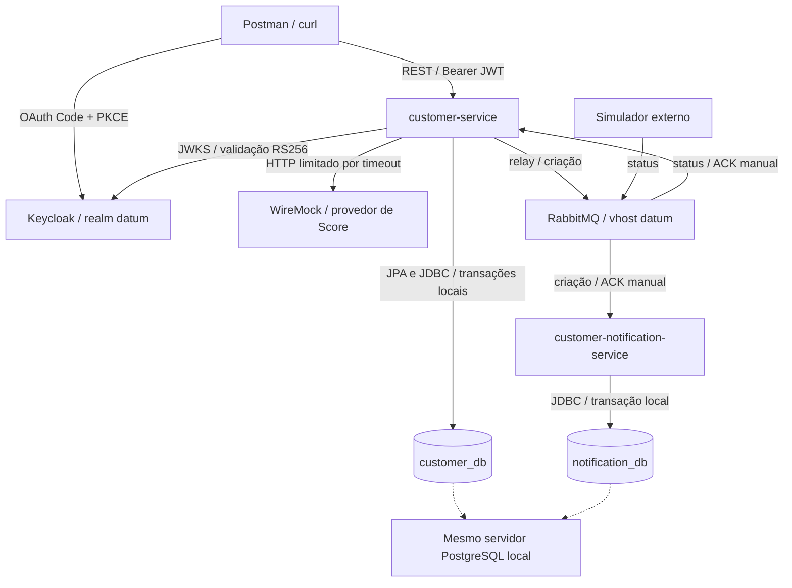
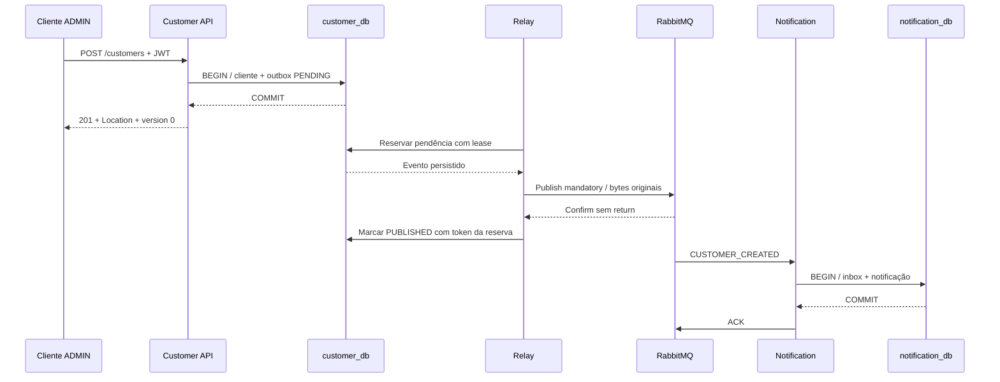
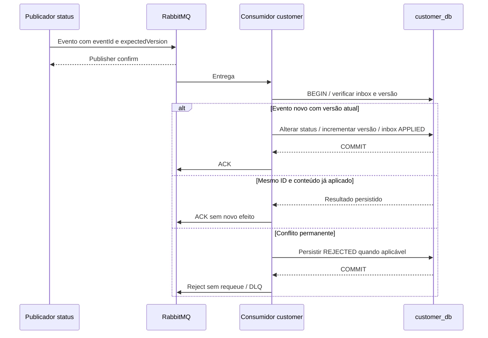
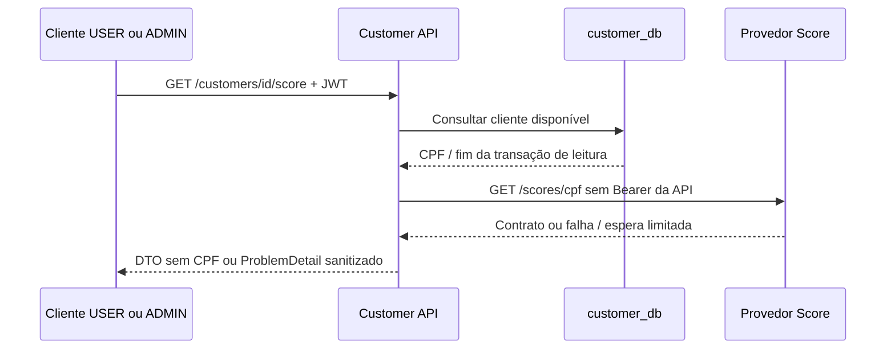

# Arquitetura implementada

[README](../README.md) · [Decisões](decisions/README.md) · [Demonstração](../guides/demo.md) · [Requisitos e evidências](../guides/requirements.md)

Este documento descreve o código entregue. As decisões originais sobre Score direto, domínio coeso, notificação independente, status no dono dos dados e persistência segregada foram preservadas. Outbox, concorrência, contratos e operação refletem os incrementos já implementados e validados.

## Componentes e propriedade dos dados

| Componente | Responsabilidade e limite |
|---|---|
| customer-service | API, validação/autorização, ciclo de vida do cliente, Score, outbox e consumidor de status |
| customer_db / customer_app | customers, customer_outbox, customer_event_inbox e histórico Flyway próprio |
| customer-notification-service | Consome criação; grava notificação simulada e inbox. HTTP somente operacional |
| notification_db / notification_app | notification_records, notification_event_inbox e histórico Flyway próprio |
| RabbitMQ | Quatro exchanges, dez filas quorum, retries/DLQs e contas segregadas |
| Keycloak | Identidade local; emite tokens, não executa regras de clientes |
| WireMock | Simula contrato e falhas do provedor externo, sem registrar journal de requisições |

Cada serviço gera seu JAR/imagem; não há dependência Maven de um serviço no outro. No customer, `api` contém DTOs/controllers/erros, `application` orquestra casos de uso, `domain` representa clientes/contratos e `infrastructure` implementa persistência, segurança, Score e mensageria. Na notificação, `application`, `domain`, `infrastructure` e `messaging` compõem o processamento independente. Não há compartilhamento de entidades JPA nem acesso cruzado aos bancos.

PostgreSQL é compartilhado fisicamente por economia local; não há transação distribuída. As contas não acessam o banco administrativo postgres nem o banco do outro serviço. A indisponibilidade desse servidor afeta ambos: isolamento de propriedade não equivale a isolamento de falha física.

## Cadastro e notificação

A ordem entre marcar PUBLISHED e iniciar o consumo não é garantida pelo diagrama: o broker pode entregar antes da atualização local do relay. PUBLISHED comprova aceitação confirmada pelo broker, não conclusão do consumidor.

A transação de cadastro inclui cliente e evento; falha em qualquer inserção reverte ambos. UUID, instante e bytes são produzidos uma vez. O relay reserva lotes com `FOR UPDATE SKIP LOCKED`, lease e token de posse; publica fora da transação de reserva. O token impede que uma confirmação tardia de um dono anterior finalize a reserva atual.

Se o broker confirmar e o processo cair antes de marcar PUBLISHED, a reserva vence e os mesmos bytes podem ser publicados outra vez. A notificação usa chave `(consumer_id,event_id)`, fingerprint e efeito na mesma transação. Reentrega idêntica gera DUPLICATE/ACK, preservando notification_id e registered_at. Não há atomicidade entre commit local e ACK; a inbox cobre essa janela. Não se promete entrega exactly-once.

Sem conexão/confirm/rota/capacidade, outbox permanece PENDING com próxima tentativa persistida. Backoff: 1/2/4/8/16/30 segundos, mantendo 30 s nas seguintes. Registro estruturalmente inválido fica BLOCKED para análise. Não há descarte por atingir três retries de outbox: esse limite pertence aos consumidores.

## Status, concorrência e exclusão

`version` inicia em zero e aumenta nas escritas de cliente. O controle otimista participa de PUT, DELETE e eventos de status. REST não exige expectedVersion no corpo; a API devolve a versão observada e trata conflitos de persistência. Mensagens exigem expectedVersion: duas intenções distintas sobre a mesma versão não são silenciosamente sobrescritas; uma pode ser rejeitada. O sistema não ordena globalmente mensagens, não mantém buffer de versões futuras e não reaplica automaticamente uma intenção obsoleta.

Duplicata significa mesmo consumidor, ID e conteúdo normalizado. Mesmo ID com outro conteúdo é conflito, não atualização. Rejeições de negócio registradas na inbox continuam rejeitadas em replay do mesmo ID. Falha transitória antes de commit não grava falsa deduplicação; payload inválido é rejeitado antes do efeito/inbox.

ACTIVE/INACTIVE são estados de negócio. DELETE preenche deleted_at e preserva status/CPF/histórico; não transforma automaticamente ACTIVE em INACTIVE. Consultas e Score ignoram excluídos; nova criação com CPF reservado retorna 409. Não há restauração, expurgo ou retenção implementados. `name_normalized` facilita busca sem distinguir caixa; acentos permanecem significativos.

## Score e isolamento da integração HTTP

O adaptador RestClient/JDK é isolado pela interface ScoreClient. Valida resposta inteira 0–1000, classificação permitida e CPF correspondente, com corpo limitado a 4 KiB. Não segue redirect nem encaminha credenciais da API. Score não é persistido/cacheado.

Conexão 500 ms, leitura 1000 ms; no máximo duas tentativas totais e pausa de 100 ms para falhas transitórias elegíveis. Timeout, 404 e resposta inválida não são repetidos. HTTP externo 500/502/503/504 e I/O sem timeout admitem retry; 429 não admite retry. Não há circuit breaker. A thread MVC aguarda a dependência, mas não retém a transação de consulta ao banco. Indisponibilidade externa não impede leitura normal do cadastro.

## Retry, DLQ e backpressure

Cada consumidor tem principal, retry 1/2/3 e DLQ; os [schemas e manifesto](../contracts/events/README.md) são a referência normativa v1. JSON fechado e metadata AMQP são validados antes da aplicação. Nenhum CPF/e-mail/JWT é incluído nos eventos.

Falha transitória publica cópia persistente no retry com confirm e sem return, depois ACK da origem. TTLs de 5/30/120 s retornam somente à fila do consumidor correspondente pelo exchange redelivery. Falha no handoff não confirma a origem; pausa/recuperação de canal evita loop imediato. Crash após confirm e antes de ACK pode duplicar a entrega; deduplicação continua necessária.

Rejeição permanente ou exaustão usa DLX para quarentena. Filas quorum e dead-letter at-least-once retêm a origem se o destino não puder receber; limites usam reject-publish, sem drop-head. Nas principais, delivery-limit 5 contém crashes sem progresso, separado das três rodadas de retry da aplicação. Pode haver mais de quatro entregas físicas por ID.

Há um nó RabbitMQ local: durable/persistent/quorum não demonstram HA nem proteção contra perda permanente de disco. As DLQs não têm consumidor, TTL ou replay automático. Recuperar a dependência não esvazia a quarentena; operador precisa avaliar causa, contrato e intenção antes de reenvio.

## Segurança, operação e sinais

JWT RS256 valida assinatura, issuer, audience, expiração e subject; roles só vêm do claim autorizado. USER consulta e ADMIN também escreve. Code + PKCE S256 em cliente público substitui senha enviada diretamente ao token endpoint. API stateless; sessões e Basic de negócio desabilitados. Swagger/OpenAPI e health têm exposição pública local explícita; demais caminhos não autorizados são recusados.

Notificação usa conta Basic restrita somente para métricas operacionais, sem dependência de login na API de clientes. Ambos os endpoints Prometheus exigem o perfil observability. Health considera banco próprio e não broker; portanto UP não significa entrega assíncrona sem atraso. `depends_on` aguarda saúde na subida inicial, não coordena transações nem recupera todo tipo de falha posterior. Healthcheck negativo sozinho não reinicia container.

Logs JSON UTC unem HTTP, Score, outbox e consumidores por correlationId; eventId identifica a intenção. Header HTTP validado segue pelo header AMQP opcional x-correlation-id, sem mudar o JSON v1 ou AMQP correlation_id=eventId. IDs não são labels de métricas. Não há APM/tracing distribuído configurado.

Flyway aplica V1–V4 em customer e V1 em notification; Hibernate valida schema, não o cria em produção. Compose mantém volumes de PostgreSQL, RabbitMQ, bootstrap e Keycloak. O init job sem rede gera definitions de forma atômica/idempotente, com hashes em volume somente leitura no broker. Aplicações rodam sem root e com limites de memória. [Operação e persistência](../infra/compose/README.md).

## Evidências e limites da demonstração

A [matriz de testes](../infra/testing/README.md) relaciona classes e cenários. O [verificador Compose](../infra/compose/verify.py) cobre bootstrap, jornada real, down/up e persistência. [Resiliência](../infra/resilience/README.md) cobre quedas, TTLs, exaustão, ACK incerto, saturação e DLQ; não simula cluster ou failover entre nós. O [relatório JMeter](../performance/performance-report.md) registra carga fechada curta, recursos compartilhados, percentis, SQL e lag. Não há evidência de SLA ou capacidade máxima.

Retenção de dados/inboxes/outbox, revisão de quarentena, TLS/segredos/HA, backup e restauração, SLOs/alertas e avaliação de carga prolongada são trabalho futuro. Escalar réplicas exige novas medições de concorrência, banco, roteamento e operação; o uso de locks/inbox não constitui por si só uma validação de escala.
